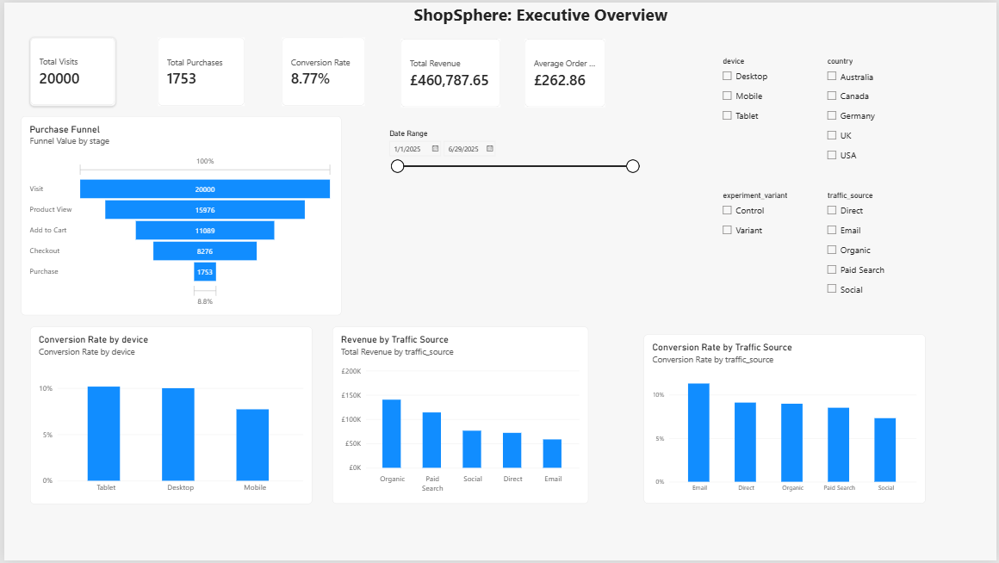
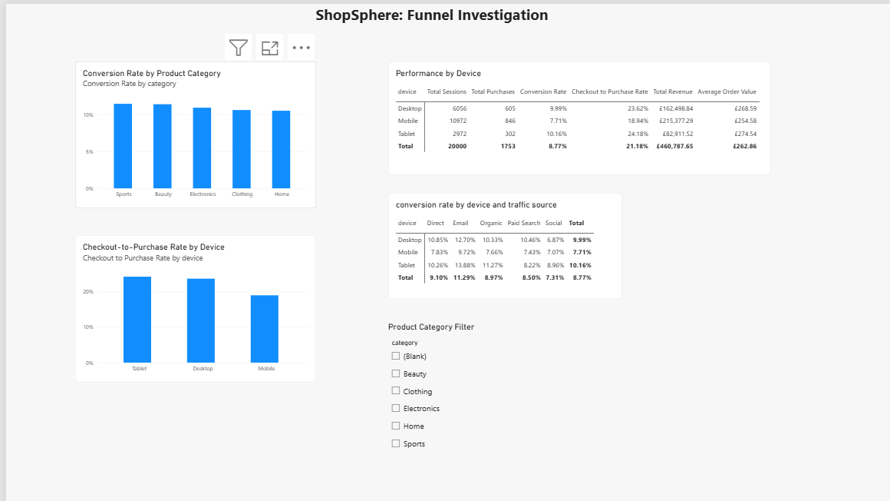
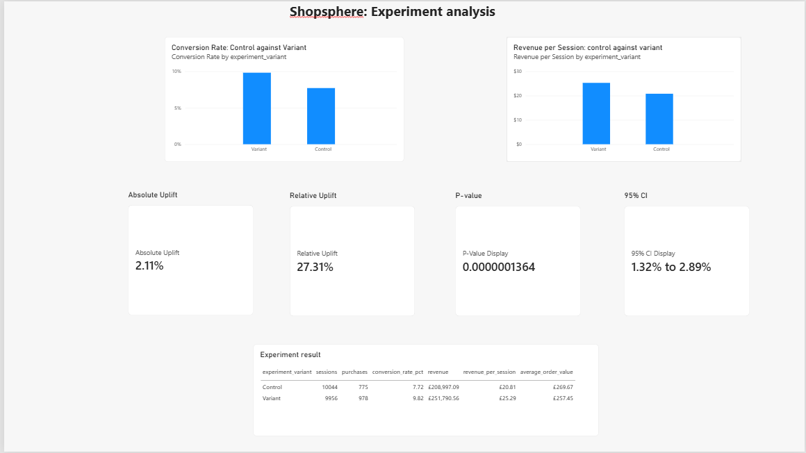

# ShopSphere — E-commerce Funnel & A/B Test Analysis

## Project Overview

ShopSphere is a fictional e-commerce analytics project designed to investigate customer behaviour across an online shopping funnel.

The project follows an end-to-end analytics workflow:

**Raw customer events → Python data validation → PostgreSQL → SQL analysis → Python statistical analysis → Power BI dashboard → Business recommendations**

The analysis focuses on:

* Customer funnel performance
* Conversion and drop-off rates
* Device, country, traffic-source and product-category performance
* Revenue and average order value
* A/B test evaluation
* Statistical significance of the experiment results
* Business recommendations based on the analysis

> **Note:** The dataset is synthetically generated for portfolio purposes. The results should not be interpreted as evidence about real customers or a real retailer.

---

## Business Questions

The project was designed to answer the following questions:

1. How many customers progress through each stage of the shopping funnel?
2. Where is the largest drop-off in the funnel?
3. How does conversion vary by device, traffic source, country and product category?
4. Which customer segments generate the most revenue?
5. Does the experimental variant have a different conversion rate from the control group?
6. How large is the observed improvement?
7. Is the difference statistically significant?
8. What areas of the customer journey could the business investigate further?

---

## Technology Stack

| Technology       | Purpose                                              |
| ---------------- | ---------------------------------------------------- |
| Python           | Data generation, validation and statistical analysis |
| Pandas           | Data manipulation and analysis                       |
| NumPy            | Numerical calculations                               |
| SciPy            | Statistical testing                                  |
| Matplotlib       | Data visualisation                                   |
| Seaborn          | Statistical visualisation                            |
| PostgreSQL       | Data storage and SQL analysis                        |
| SQL              | Funnel, segmentation and revenue analysis            |
| Power BI         | Interactive dashboard                                |
| Jupyter Notebook | Data-quality investigation                           |
| Git & GitHub     | Version control                                      |

---

## Project Structure

```text
shopsphere-funnel-analysis/
│
├── data/
│   ├── raw/
│   └── processed/
│
├── notebooks/
│   └── 01_data_quality_check.ipynb
│
├── python/
│   ├── generate_data.py
│   └── ab_test_analysis.py
│
├── sql/
│   ├── 01_create_table.sql
│   ├── 02_funnel_analysis.sql
│   └── 03_create_analytical_view.sql
│
├── powerbi/
│   └── shopsphere_dashboard.pbix
│
├── README.md
└── requirements.txt
```

---

## Dataset

The dataset contains synthetic customer event data representing an e-commerce website.

### Dataset size

* **20,000 users**
* **20,000 sessions**
* **57,094 customer events**
* Data period: January–June 2025

### Funnel stages

```text
Website Visit
      ↓
Product View
      ↓
Add to Cart
      ↓
Checkout Started
      ↓
Purchase
```

The raw event data contains information including:

* User ID
* Session ID
* Event timestamp
* Event type
* Product
* Product category
* Device
* Country
* Traffic source
* Experiment variant
* Product price

---

## Data Quality

Before analysis, the dataset was validated using Python and Jupyter.

Checks included:

* Missing-value analysis
* Duplicate-row detection
* Duplicate event-ID detection
* Valid categorical values
* Timestamp validation
* Event ordering
* Session-level visit validation
* Purchase/checkout consistency
* Price validation

Key results:

* **0 duplicate rows**
* **0 duplicate event IDs**
* Every session contained a visit event
* No purchases occurred without a checkout event
* Expected missing values were limited to fields that are not applicable to certain event types, such as product information on initial visits

---

## Key Funnel Results

| Funnel Stage | Sessions |
| ------------ | -------: |
| Visit        |   20,000 |
| Product View |   15,976 |
| Add to Cart  |   11,089 |
| Checkout     |    8,276 |
| Purchase     |    1,753 |

Overall conversion from visit to purchase was:

**8.77%**

The largest relative drop-off occurred between **checkout and purchase**, where the checkout-to-purchase conversion rate was approximately **21.18%**.

This identifies checkout completion as an area for further investigation, although the analysis does not establish the underlying cause of the drop-off.

---

## Revenue Analysis

Total simulated revenue:

**£460,787.65**

Total purchases:

**1,753**

Average order value:

**£262.86**

Device-level conversion rates were:

| Device  | Conversion Rate |
| ------- | --------------: |
| Mobile  |           7.71% |
| Desktop |           9.99% |
| Tablet  |          10.16% |

Mobile generated the largest total revenue because it represented the largest number of sessions, while its conversion rate was lower than desktop and tablet.

This suggests mobile checkout and purchasing behaviour could be investigated further.

---

## A/B Test Analysis

The experiment compared two groups:

* **Control**
* **Variant**

### Results

| Metric              |     Control |     Variant |
| ------------------- | ----------: | ----------: |
| Sessions            |      10,044 |       9,956 |
| Purchases           |         775 |         978 |
| Conversion Rate     |       7.72% |       9.82% |
| Revenue             | £208,997.09 | £251,790.56 |
| Revenue / Session   |      £20.81 |      £25.29 |
| Average Order Value |     £269.67 |     £257.45 |

The observed conversion-rate difference was:

**+2.11 percentage points**

The relative uplift was:

**+27.31%**

A two-proportion z-test was used to evaluate the conversion-rate difference.

Results:

* **z-statistic:** 5.27
* **p-value:** 0.0000001364
* **95% confidence interval:** 1.32 to 2.89 percentage points

Under the assumptions of the two-proportion z-test, these results provide strong statistical evidence that the conversion rates differed between the two experiment groups.

Because the data is synthetic, this statistical result demonstrates the analytical methodology rather than providing evidence about a real-world experiment.

---

## Business Insights

### 1. Checkout is a major funnel investigation point

Only around 21% of checkout-starting sessions resulted in a purchase.

Potential areas for further investigation could include:

* Checkout usability
* Payment failures
* Unexpected costs
* Delivery information
* Account requirements
* Mobile checkout experience

The current dataset does not contain enough information to determine which of these factors, if any, caused the drop-off.

### 2. Mobile conversion is lower than desktop and tablet

Mobile conversion was **7.71%**, compared with **9.99%** on desktop and **10.16%** on tablet.

This makes the mobile customer journey a useful area for further investigation.

### 3. Email had the highest conversion rate by traffic source

Email sessions converted at approximately **11.29%**.

However, acquisition costs are not included in the dataset, so conversion rate alone cannot determine channel profitability.

### 4. The experimental variant produced higher conversion

The variant recorded a conversion rate of **9.82%**, compared with **7.72%** for the control group.

The observed difference was **2.11 percentage points**, with a relative uplift of **27.31%**.

The statistical analysis found strong evidence of a difference in conversion rates under the assumptions of the selected test.

---

## Power BI Dashboard

The Power BI report contains three pages:

### Executive Overview



### Funnel Investigation



### Experiment Analysis




### 1. Executive Overview

Provides a high-level view of:

* Total visits
* Purchases
* Conversion rate
* Revenue
* Average order value
* Conversion by device
* Conversion by traffic source
* Revenue by traffic source
* Interactive filters

### 2. Funnel Investigation

Explores:

* Conversion by product category
* Checkout-to-purchase conversion
* Device performance
* Device × traffic-source performance
* Session and revenue metrics

### 3. Experiment Analysis

Shows:

* Control vs Variant conversion
* Revenue per session
* Absolute uplift
* Relative uplift
* P-value
* 95% confidence interval
* Detailed experiment results

---

## Analytical Approach

The project deliberately separates different stages of the analytics workflow.

### Python

Used for:

* Data generation
* Data-quality validation
* Statistical analysis
* A/B test calculations
* Statistical visualisation

### PostgreSQL

Used for:

* Structured data storage
* SQL funnel analysis
* Segmentation
* Revenue calculations
* Creation of an analytical session-level view

### Power BI

Used for:

* Interactive dashboarding
* KPI reporting
* Filtering
* Funnel visualisation
* Experiment comparison
* Business-facing presentation

---

## Limitations

This project uses synthetic data, so the results should not be interpreted as real-world customer evidence.

Additional limitations include:

* No marketing-cost data
* No customer lifetime value
* No detailed checkout failure information
* No qualitative customer feedback
* No genuine longitudinal retention data
* One generated session per user, preventing meaningful cohort-retention analysis

These limitations provide opportunities for future extensions of the project.

---

## Future Improvements

Potential future improvements include:

* Connecting the dashboard to a larger production-style dataset
* Adding marketing-cost and ROI analysis
* Adding customer lifetime value
* Adding checkout-error analysis
* Adding cohort analysis using repeat sessions
* Automating the data pipeline
* Connecting Power BI directly to a refreshed database
* Adding automated statistical reporting
* Deploying the analytical pipeline using scheduled workflows

---

## Conclusion

ShopSphere demonstrates an end-to-end data analytics workflow from raw event data through data validation, SQL analysis, statistical testing and interactive business reporting.

The project combines **Python, PostgreSQL, SQL, statistical analysis and Power BI** to transform customer-event data into measurable business insights.
